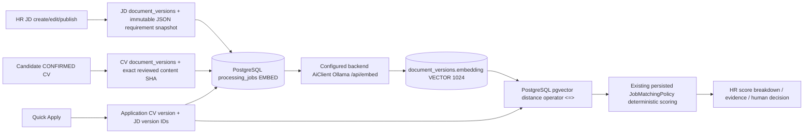

# MidCV — Architectural patch, evidence register, acceptance boundaries

**Snapshot 2026-11-04.** Based only on supplied source ZIP and pasted master prompt. No official proposal PDF, RTM DOCX, Git metadata, live services, or credentials were available in this environment. This is not a claim of completed project acceptance.

## Production design changed by this overlay

**Canonical store for the new application path**: `document_versions.embedding`. Legacy `embeddings.embedding_vector` (1536) and `embeddings.embedding_vector_1024` are preserved; the metadata-only writer was disabled rather than claiming that a row equals a vector. V32 is additive and does not backfill unverifiable provenance. CV `source_sha` is the raw-input checksum; `embedding_source_sha` is the reviewed professional-content checksum. The JD SHA covers ordered deterministic description and requirements, while normalized JSON captures the JD policy input. A new JD version is inserted whenever canonical text changes, and the application pins a specific version.

**Real provider configuration:** `AiClient.activeEmbeddingModel()` reads existing persisted `system_ai_settings.embedding_model` (falling back to existing configuration); `AiClient.embed()` calls backend-configured Ollama `/api/embed`, rejects empty vectors and non-1024 dimensions, and checks a returned model name if provided. An OpenAI-compatible **chat** proxy does not by itself meet the embedding dependency.

**Effective scoring policy** remains the existing `JobMatchingPolicy` (default current source values: REQUIRED .32, PREFERRED .08, EXPERIENCE .25, EDUCATION .10, PROJECT .10, SEMANTIC .15; CORE .85, GitHub .15 when applicable). Runtime persisted job policy overrides defaults. No invented weights or historical results were changed. The existing engine dynamically normalizes applicable weights; direct Pgvector and concept fallback are distinguished in the factor and returned method.

**Important incompleteness:** This overlay has not delivered field-level JD extraction from an LLM with verifiable spans; section-aware vectors; canonical embedding model *version* (only actual model identifier is stored); signed source offsets; recalculation invalidation on **every** matching-policy update; independent ground-truth benchmarks; production performance measurement; complete GitHub live acceptance; recovery rehearsal; or full Playwright Candidate-to-HR browser E2E. These requirements remain open.

## Execution ledger (not acceptance claims)

| MID | Status in this delivery | Evidence/remaining gate |
|---|---|---|
| MID-01 | **PARTIAL** | Version-bound CV/JD lifecycle and queue introduced; PostgreSQL migration/live operator still unrun |
| MID-02 | **PARTIAL** | New canonical writer and legacy fake metadata writer disabled; real model/index/upgrades unverified |
| MID-03 | **NOT COMPLETED** | JD JSON snapshot is created from HR-entered fields; real LLM JD structuring/evidence not implemented |
| MID-04 | **PARTIAL** | Exact source substring used for skill evidence; full citation offset/provenance contract absent |
| MID-05 | **NOT COMPLETED** | No browser + real Candidate/HR E2E executed |
| MID-06 | **NOT COMPLETED** | No new independently annotated >10 extraction dataset; no fabricated labels |
| MID-07 | **NOT COMPLETED** | No graded ranking benchmark; no fabricated NDCG |
| MID-08 | **PARTIAL** | Existing weights preserved, runtime policy version exposed, fallback identified; no complete cross-channel recomputation |
| MID-09 | **NOT COMPLETED** | No real upload/SSE/restart/JPA acceptance tests performed |
| MID-10 | **NOT COMPLETED** | Existing GitHub scoring preserved; no new live ownership/limits acceptance |
| MID-11 | **NOT COMPLETED** | Existing cache preserved; no production multi-instance invalidation acceptance |
| MID-12 | **NOT COMPLETED** | No p50/p95/p99 real traffic load results |
| MID-13 | **PARTIAL** | Technology false-equivalence regression tests added; no full industry multilingual benchmark |
| MID-14 | **NOT COMPLETED** | No comprehensive security or prompt-injection acceptance |
| MID-15 | **NOT COMPLETED** | No Docker/backup/restore rehearsal |
| MID-16 | **PARTIAL** | Transparent patch ledger; official RTM and historical reports unavailable for reconciliation |
| MID-17 | **NOT COMPLETED** | No real demo test accounts/screenshots, to avoid inventing evidence |

### Acceptance gate status

**G1…G10: ALL NOT ACCEPTED.** Individual patch features or unit tests cannot establish whole-product readiness. PostgreSQL integration, production builds, live AI provider, and Playwright E2E require testing in the developer's environment.

## Detailed sanity checks for developer

1. Backup DB and uploads; use a disposable/staging PostgreSQL first. Start backend to apply Flyway V32. Check that `processing_jobs.kind='EMBED'` is allowed.
2. Ensure backend sees a working Ollama `/api/embed` model returning a real 1024-element vector, consistent with `system_ai_settings.embedding_model`. A chat-completion-only provider does not suffice.
3. Candidate confirms reviewed CV, or applies with a previously confirmed version; HR creates/publishes JD. Inspect `processing_jobs` progress and error codes (no manual INSERT).
4. Quick Apply to JD; inspect `applications.applied_cv_version_id`, `applications.applied_jd_version_id` and corresponding `document_versions` (hash, model, embedding_dimension, READY, actual non-NULL vector). The worker should rerun MATCH when either vector becomes READY.
5. With real data present, execute `scripts/Test-MidcvPgvectorLive.ps1`. The script uses PostgreSQL's `<=>` and fails unless a MATCH result records Pgvector success.
6. Check HR score breakdown actual method/versions, retry failures, re-edit JD and verify old application pins old JD version. Check exact-skill false equivalence, GitHub absent/non-IT behavior, tenant/ownership restrictions, and backend crash/restart.
7. Re-run `mvn -f backend/pom.xml test`; Python pytest; frontend build and browser E2E. Record stderr, migration version, provider model/dim, SQL results, and commit SHA on a real Git checkout.

### Environmental blockers

- Missing Maven, Docker, live PostgreSQL/Pgvector, backend Ollama, frontend node_modules and configured browser test accounts.
- User-uploaded archive contains no `.git` directory, hence no branch baseline or commit metadata. The required exact per-task branches/commits must be made by owner in a real clone; not simulated by this patch archive.
- Official proposal and named MidCV RTM files not present in archive. Their academic coverage cannot be truthfully certified.
- Python suite collected 257 tests; executed with `--maxfail=1`: 100 PASS and 1 FAIL due to an external live GitHub API test encountering DNS resolution failure (`httpx.ConnectError`). Remaining tests not asserted PASS. Separate focused regression run: 8 PASS. Other offline suite run timed out.

**Rollback:** Restore backup/project copy and database backup when needed; V32 is additive but *do not* assume rolling back Java code automatically rolls back a Flyway migration. Never delete historical `document_versions` or old embeddings as a shortcut.
