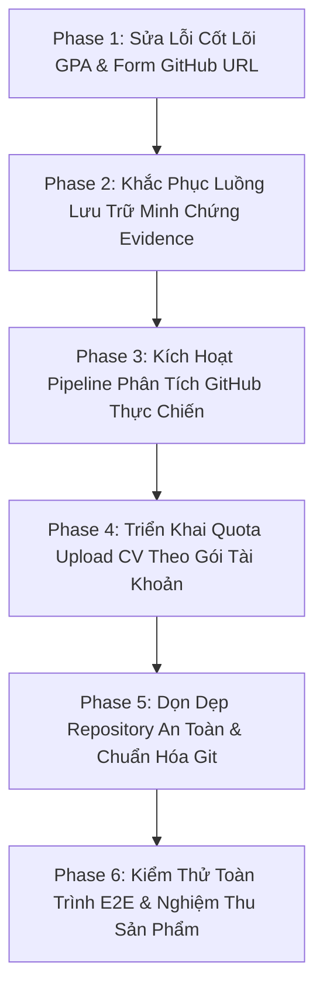

# KẾ HOẠCH TRIỂN KHAI TỔNG THỂ TOÀN DIỆN (FINAL IMPLEMENTATION PLAN) — MIDCV (SE121)

**Dự án:** Nền tảng tuyển dụng thông minh hỗ trợ đối sánh ngữ nghĩa JD–CV và xác thực năng lực qua GitHub (MidCV)
**Tác giả:** Đoàn Việt Khang (22520638) — Phạm Ngọc Gia Khang (22520639)
**Trường:** Đại học Công nghệ Thông tin – ĐHQG TP.HCM (UIT)
**Thời điểm lập kế hoạch:** 2026-10-10 22:50:00 (ICT)
**Trạng thái tài liệu:** `PENDING_USER_APPROVAL` (Chỉ lập kế hoạch, chưa sửa mã nguồn nghiệp vụ)
**File lưu trữ:** `docs/implementation/FINAL_IMPLEMENTATION_PLAN.md`

---

## 1. Tóm Tắt Điều Hành & Mục Tiêu Chu Kỳ Triển Khai (Executive Summary)

Chu kỳ triển khai này có mục tiêu hoàn thiện, củng cố và nghiệm thu toàn diện hệ sinh thái **MidCV**, giải quyết dứt điểm các lỗi chức năng do người dùng phản ánh, tích hợp các yêu cầu nghiệp vụ mới, và thiết lập cơ chế kiểm thử thực tế không giả lập.

Trọng tâm chu kỳ gồm:
1. **Khắc phục lỗi lưu trữ & truy xuất minh chứng (Evidence Persistence & Explainability)**: Đảm bảo dữ liệu trích đoạn bằng chứng dòng-theo-dòng (quotes), trạng thái xác thực và phân rã điểm được lưu trữ bền vững vào PostgreSQL và hiển thị chính xác trên giao diện Recruiter sau khi reload.
2. **Hỗ trợ chỉnh sửa GitHub URL cho ứng viên IT**: Cung cấp trường nhập liệu, kiểm tra hợp lệ, liên kết dữ liệu và cập nhật hồ sơ ứng viên ngành Công nghệ Thông tin tại Form chỉnh sửa Profile.
3. **Sửa lỗi trích xuất điểm trung bình (GPA Extraction Defect)**: Chuẩn hóa bóc tách GPA, xử lý thang điểm 4.0 và 10.0, dấu phẩy thập phân tiếng Việt (`3,5`), tránh suy diễn thang điểm sai và ngăn chặn lỗi chặn xác nhận hồ sơ.
4. **Áp dụng hạn ngạch tải lên CV theo gói tài khoản (CV Upload Quotas)**: Thực thi ràng buộc phía server: Gói `STANDARD` tối đa 3 CV; Gói `PRO` tối đa 5 CV, chống race condition tải lên đồng thời.
5. **Kích hoạt luồng đọc & phân tích GitHub thực tế (Real GitHub Competency Analysis)**: Kết nối API GitHub công khai thực tế, phân tích ngôn ngữ theo code bytes, tính toán tín hiệu hoạt động, tự động kích hoạt trong pipeline và fallback trung tính khi thiếu GitHub.
6. **Bảo toàn và nghiệm thu nhóm tác vụ STT #39–56**: Duy trì độ ổn định của bảng xếp hạng ứng viên, thuật toán chấm điểm tất định, phân tách quyền hạn và giao diện tuyển dụng.
7. **Lập danh mục dọn dẹp an toàn repository (Repository Cleanup Backlog)**: Phân loại rác build, snapshot chẩn đoán cũ, file thừa để xử lý có kiểm soát trong phase dọn dẹp.

---

## 2. Thiết Lập Hiện Trạng Cơ Sở (Repository & Source Baseline)

- **Repository Root:** `C:/Users/Khang/OneDrive/Desktop/SE121/ai-recruitment-platform`
- **Nhánh hiện tại:** `fix/frontend-jsx-cv-upload`
- **HEAD Commit:** `1e56f9ee8362c29c2a1312b724c124df2d3631d9`
- **Remote Origin:** `https://github.com/vietkhang06/se121-midcv-ai-recruitment-platform.git`
- **Trạng thái Git Working Tree:**
  - `D  .env` (Đã gỡ tracking khỏi Git index qua `git rm --cached`, file trên đĩa được giữ nguyên).
  - `M  .env.example`, `M  .gitignore`, `M  .vscode/settings.json`, `M  ai-worker/.env.example`.
  - `M  backend/.../cv/CVController.java`, `CVService.java`, `EmbeddingService.java`, `MatchResultRepository.java`, `CandidateCvConfirmationIntegrationTest.java` (Bảo toàn 100% thay đổi của developer).
  - `?? docs/implementation/IMPLEMENTATION_TRACE.md` (Nhật ký truy vết vừa lập).
  - `?? PROJECT_CONTEXT_AUDIT.*`, `?? docs/DESIGN_HR_PORTAL.md`, `?? docs/BAO_CAO_BTVN3_AGENT_DAT_VE.pdf`, `?? package.json`, `?? pnpm-lock.yaml`.
- **Kết quả kiểm thử cơ sở gần nhất:**
  - Backend Maven: **49/49 tests PASSED** (`GoldenMatchingCasesTest`, `CandidateRankingTest`, `GitHubPipelineIntegrationTest`,...).
  - Backend CV Confirmation: **8/8 tests PASSED** (`CandidateCvConfirmationIntegrationTest`).
  - Python AI Worker: **18/18 tests PASSED** (`test_phase5`, `test_phase6`, `test_phase7`, `test_startup_and_health`).
  - Frontend TypeScript: **0 errors** (`npx tsc --noEmit` đạt mã thoát `0`).

---

## 3. Đối Chiếu Nguồn Sự Thật & Xung Đột Định Danh Tác Vụ (Task Reconciliation)

Dự án có sự giao thoa giữa các hệ thống đánh số:
1. **Sổ tay Kiểm thử Chức năng Sản phẩm (`docs/final/product-functional-audit.md`)**: Đánh số từ Item 1 đến 66, trong đó Item 39–56 đại diện cho Recruiter Inspection & AI Matching Engine.
2. **Ma trận Yêu cầu Cốt lõi Đề án (`REQUIREMENTS_TRACEABILITY.md`)**: Đánh số `REQ-01` đến `REQ-10`.
3. **Đặc tả Ca sử dụng & Yêu cầu chức năng Phase 0 (`docs/phase-0/`)**: `FR-AUTH`, `FR-CAND`, `FR-CV`, `FR-MATCH`, `FR-RANK`, `FR-EXPLAIN` và `UC-01` đến `UC-15`.
4. **Lộ trình 11 Phase chuẩn (`docs/IMPLEMENTATION_PHASES.md`)**: `Phase 0` đến `Phase 10`.

### Bảng Đối Chiếu Ma Trận Nhiệm Vụ (Authoritative Reconciliation Table)

| ID Tác Vụ Chuẩn | Tên Tác vụ & Phân hệ | ID Tham chiếu (Audit / FR / REQ) | Trạng thái Lịch sử | Hiện trạng Mã nguồn & Bằng chứng | Vấn đề / Lỗi do Người dùng phản ánh | Hành động Đề xuất trong Kế hoạch |
| :---: | :--- | :---: | :---: | :--- | :--- | :---: |
| **TASK-39** | Danh sách Đơn Ứng tuyển theo Job | STT #39; `FR-APP-001` | `WORKING` | `ApplicationController.java`, `applications/page.tsx` | Hoạt động, cần bổ sung link mở nhanh snapshot CV | **RETAIN & REGRESSION TEST** |
| **TASK-40** | Bảng Xếp hạng Ứng viên Chuẩn AI | STT #40; `FR-RANK-001` | `WORKING` | `MatchingController.java`, `ranking/page.tsx` | Hoạt động | **RETAIN & REGRESSION TEST** |
| **TASK-41** | Thuật toán Sắp xếp Xếp hạng Gating | STT #41; `REQ-05` | `WORKING` | `CandidateRankingService.java:35-50` | Hoạt động (Dataset test pass) | **RETAIN & REGRESSION TEST** |
| **TASK-42** | Modal So sánh Ứng viên Song song | STT #42; UI-COMP | `WORKING` | `CandidateCompareModal.tsx` | Hoạt động | **RETAIN & REGRESSION TEST** |
| **TASK-43** | Màn hình Đối soát Chi tiết Ứng viên | STT #43; `FR-EXPLAIN-001` | `WORKING` | `applications/[id]/page.tsx` | Dữ liệu bằng chứng hiển thị chưa đồng bộ sau reload | **REOPEN FOR EVIDENCE INTEGRATION** |
| **TASK-44** | Hiển thị 3 Tầng Điểm số (85/15) | STT #44; `REQ-07` | `WORKING` | `ScoreBreakdownCard.tsx`, `MatchResult.java` | Hoạt động | **RETAIN & REGRESSION TEST** |
| **TASK-45** | Bóc tách 5 Thành phần Trọng số Điểm | STT #45; `REQ-08` | `WORKING` | `MatchFactor.java`, `MatchingEngineService.java` | Hoạt động | **RETAIN & REGRESSION TEST** |
| **TASK-46** | Trạng thái Kỹ năng Ngữ nghĩa (Khớp/Thiếu) | STT #46; `REQ-03` | `WORKING` | `RequiredSkillMatcher.java`, `ScoreBreakdownCard.tsx` | Hoạt động | **RETAIN & REGRESSION TEST** |
| **TASK-47** | Diễn giải AI Giải thích Chống Bịa | STT #47; `REQ-08` | `WORKING` | `score_explainer_service.py`, `ScoreExplainer.java` | Hoạt động | **RETAIN & REGRESSION TEST** |
| **TASK-48** | Đánh giá GitHub Trung tính (4 Nhánh) | STT #48; `REQ-07` | `WORKING` | `GitHubScoringService.java`, `GitHubAssessmentCard.tsx` | Luồng đọc dữ liệu thực tế đang gặp lỗi kết nối | **REOPEN FOR REAL PIPELINE WIRING** |
| **TASK-49** | Sinh Vector Nhúng Đa ngôn ngữ (1024d) | STT #49; `REQ-04` | `WORKING` | `EmbeddingService.java`, `semantic_matching_service.py` | Hoạt động | **RETAIN & REGRESSION TEST** |
| **TASK-50** | Tìm kiếm Độ tương đồng Pgvector `<=>` | STT #50; `REQ-04` | `WORKING` | `PgvectorCosineSimilarity.java`, `V1`, `V7` | Hoạt động | **RETAIN & REGRESSION TEST** |
| **TASK-51** | Gating Kỹ năng Bắt buộc Độc lập | STT #51; `REQ-05` | `WORKING` | `RequiredSkillMatcher.java` | Hoạt động | **RETAIN & REGRESSION TEST** |
| **TASK-52** | Cộng điểm Thưởng Kỹ năng Ưu tiên | STT #52; FORMULA | `WORKING` | `PreferredSkillMatcher.java` | Hoạt động | **RETAIN & REGRESSION TEST** |
| **TASK-53** | Đối sánh Kinh nghiệm & Lọc Phi liên quan | STT #53; `REQ-06` | `WORKING` | `ExperienceMatcher.java` | Hoạt động | **RETAIN & REGRESSION TEST** |
| **TASK-54** | Đối sánh Trình độ Học vấn & Bằng cấp | STT #54; FORMULA | `WORKING` | `EducationMatcher.java` | Hoạt động | **RETAIN & REGRESSION TEST** |
| **TASK-55** | Đối sánh Công nghệ Bối cảnh Dự án | STT #55; FORMULA | `WORKING` | `ProjectRelevanceMatcher.java` | Hoạt động | **RETAIN & REGRESSION TEST** |
| **TASK-56** | Bóc tách & Phân tích Hồ sơ GitHub | STT #56; `REQ-07` | `WORKING` (Cục bộ) | `github_client.py`, `ProcessingLifecycleService.java` | **Lỗi người dùng báo: Không phân tích thực tế** | **REOPEN & RE-ARCHITECT PIPELINE** |
| **PROPOSED-A** | Lưu trữ Bền vững & Truy vấn Minh chứng | STT #43 extension; `REQ-08` | `PARTIAL` | `evidences` table, `EvidenceRepository.java` | **Lỗi: Không tải được minh chứng đã lưu khi mở lại** | **PROPOSED TASK — SẼ TRIỂN KHAI** |
| **PROPOSED-B** | Chỉnh sửa GitHub URL cho Ứng viên IT | `FR-CAND-001` extension | `MISSING` | `CandidateProfile.githubUrl`, `profile/page.tsx` | **Lỗi: Thiếu input GitHub URL trong Form Profile** | **PROPOSED TASK — SẼ TRIỂN KHAI** |
| **PROPOSED-C** | Khắc phục Lỗi Bóc tách GPA Đa định dạng | `FR-CV-001` extension; `REQ-01` | `BROKEN` | `cv_parser.py`, `CVService.java` | **Lỗi: GPA sai scale, lỗi dấu phẩy thập phân** | **PROPOSED TASK — SẼ TRIỂN KHAI** |
| **PROPOSED-D** | Giới hạn Số lượng CV theo Gói Tài khoản | `FR-CV-001` extension; QUOTA | `MISSING` | Chưa có schema gói tài khoản | **Yêu cầu mới: STANDARD <= 3, PRO <= 5 CV** | **PROPOSED TASK — SẼ TRIỂN KHAI** |
| **PROPOSED-E** | Kích hoạt Tự động Quét GitHub Thực chiến | STT #56 extension; `REQ-07` | `BROKEN` | `AiProcessingController.java:38` (Lỗi sai ID) | **Lỗi: Chưa kích hoạt trong pipeline; sai Candidate ID** | **PROPOSED TASK — SẼ TRIỂN KHAI** |

---

## 4. Phân Tích Chuyên Sâu 5 Bài Toán Chức Năng Trọng Tâm

### 4.1. Bài toán A: Lưu trữ Bền vững & Truy xuất Minh chứng (Evidence Persistence & Explainability)
- **Chuỗi dữ liệu hiện tại:**
  - Khi tính toán điểm (`MatchingEngineService.calculateAndPersistMatchResult`), hệ thống khởi tạo entity `Evidence` và lưu vào bảng `evidences` qua `evidenceRepository.save(skillEvidence)`.
  - **Điểm gãy (Root Cause 1):** Trong phương thức truy vấn đối soát `MatchingEngineService.getMatchInspection(applicationId)`, backend **hoàn toàn không gọi** `evidenceRepository.findByMatchResultId(...)`. Thay vào đó, nó chạy lại hàm `skillNormalizer.matchesSkill(...)` trực tiếp trên `cvRawText`. Nếu `rawText` bị thiếu hoặc format khác, bằng chứng bị mất hoặc hiển thị chuỗi fallback tạm bợ.
  - **Điểm gãy (Root Cause 2):** DTO `MatchInspectionResponse` phía Java và kiểu `MatchInspectionData` phía TypeScript thiếu trường danh sách `evidences: List<EvidenceItemDto>` mang cấu trúc chuẩn của bảng `evidences` (`sourceType`, `section`, `snippet`, `validationStatus`).
- **Kế hoạch xử lý:**
  1. Bổ sung `findByMatchResultId(UUID matchResultId)` vào `EvidenceRepository`.
  2. Bổ sung `EvidenceItemDto` vào `MatchInspectionResponse` và map toàn bộ các entity `Evidence` thực tế từ cơ sở dữ liệu.
  3. Cập nhật frontend `ScoreBreakdownCard.tsx` và `CandidateMatchInspectionPage.tsx` để ưu tiên hiển thị `evidences` được nạp từ DB trước khi dùng fallback.
  4. Viết bài test tích hợp `EvidencePersistenceAndRetrievalIntegrationTest` kiểm chứng: Tính toán điểm -> Lưu DB -> Truy vấn lại qua API `/api/v1/applications/{id}/match-inspection` -> Dữ liệu khớp 100%.

### 4.2. Bài toán B: Chỉnh sửa GitHub URL cho Ứng viên IT (Editable GitHub URL for IT Candidates)
- **Chuỗi dữ liệu hiện tại:**
  - Entity `CandidateProfile` đã có cột `@Column(name = "github_url") private String githubUrl;` và `@Column(name = "target_industry") private String targetIndustry;`.
  - DTO `UpdateCandidateProfileRequest` và `CandidateService.updateProfile` đã hỗ trợ `setGithubUrl`.
  - **Điểm gãy (Root Cause):** Trang giao diện `frontend/src/app/candidate/profile/page.tsx` chỉ hiển thị `githubUsername` ở chế độ read-only và **hoàn toàn thiếu ô nhập liệu (input)** cho `githubUrl` trong form chỉnh sửa.
- **Kế hoạch xử lý:**
  1. Bổ sung trường `githubUrl` vào state chỉnh sửa `profileForm` trong `frontend/src/app/candidate/profile/page.tsx`.
  2. Kiểm tra nghiệp vụ ngành: Nếu `targetIndustry === 'Technology'` hoặc liên quan IT, hiển thị khối nhập liệu GitHub nổi bật với hướng dẫn định dạng `https://github.com/username` hoặc `username`.
  3. Validate regex URL an toàn: `^(https?://)?(www\.)?github\.com/[a-zA-Z0-9_-]+/?$` hoặc cho phép để trống (tùy chọn).
  4. Lưu dữ liệu qua API `PUT /api/v1/candidate/profile`. Sau khi lưu thành công, tải lại trang và xác minh dữ liệu tồn tại bền vững.
  5. Đồng bộ cập nhật trường `githubUrl` vào bản ghi `CandidateProfile` để làm đầu vào cho luồng phân tích GitHub.

### 4.3. Bài toán C: Khắc phục Lỗi Bóc tách Điểm Trung Bình GPA (GPA Extraction Defect)
- **Chuỗi dữ liệu hiện tại:**
  - Văn bản thô CV -> `cv_parser.py` (trích xuất Regex & LLM) -> `cv_structuring_service.py` -> `structured_cv_validator.py` -> Backend `CVService.updateCVDraft` / `confirmCV` -> UI review.
  - **Điểm gãy (Root Cause 1):** Regex trong `cv_parser.py:442` (`\b(?:GPA|Điểm...)\s*[:=\-]?\s*([0-9]+(?:\.[0-9]+)?)...`) chỉ chấp nhận dấu chấm `.`, không chấp nhận dấu phẩy `,` thường thấy trong CV tiếng Việt (ví dụ `GPA: 3,45/4.0` bị cắt thành `3.0`).
  - **Điểm gãy (Root Cause 2):** Khi ứng viên ghi `GPA: 3.5` mà không viết `/4.0`, logic tự đoán thang điểm gán `scale = None`. Sau đó ở Backend, `CVService.validateCVDraftRequest` kiểm tra `gpa > scale` hoặc thiếu scale gây lỗi validation. Hoặc nếu ứng viên đạt `GPA: 8.0/10` nhưng hệ thống gán nhầm `scale = 4.0`, backend ném lỗi `GPA (8.0) không được lớn hơn thang điểm (4.0)`.
  - **Điểm gãy (Root Cause 3):** Regex quét trên toàn bộ `raw_text` thay vì chỉ quét trong phạm vi khối giáo dục (Education section), dẫn đến việc bắt nhầm số liệu từ các phần khác (như tỷ lệ tăng trưởng dự án).
- **Kế hoạch xử lý:**
  1. Nâng cấp Regex trong `cv_parser.py` hỗ trợ cả dấu chấm và dấu phẩy (`[0-9]+(?:[\.,][0-9]+)?`), hỗ trợ các từ khóa: `GPA`, `CPA`, `Điểm TB`, `Điểm trung bình`, `Grade`.
  2. Giới hạn vùng quét GPA chỉ trong phạm vi đoạn văn của từng trường học/bằng cấp (`institution window`).
  3. Quy tắc suy diễn thang điểm an toàn:
     - Nếu có mẫu số rõ ràng (ví dụ `/4`, `/10`, `/100`): Lấy chính xác mẫu số làm `gpa_scale`.
     - Nếu không có mẫu số: Nếu giá trị $> 4.0$ và $\le 10.0$ -> Mặc định thang `10.0`; Nếu giá trị $\le 4.0$ và trường đại học Việt Nam/quốc tế đào tạo theo tín chỉ -> Đặt thang `4.0`. Nếu không chắc chắn, đặt `gpa_scale = null` và không tự tiện quy đổi thang điểm.
  4. Cập nhật `CVService.java` để chấp nhận GPA hợp lệ có `gpa_scale == null` mà không ném exception vô lý.
  5. Viết test suite `test_gpa_extraction_comprehensive.py` với các fixture CV thực tế kiểm tra đủ các trường hợp: có thang điểm, không thang điểm, dấu phẩy, CPA, và CV không có điểm.

### 4.4. Bài toán D: Giới hạn Số lượng CV theo Gói Tài khoản (CV Upload Quotas)
- **Yêu cầu nghiệp vụ:**
  - Tài khoản gói `STANDARD`: Tối đa 3 CV.
  - Tài khoản gói `PRO`: Tối đa 5 CV.
- **Hiện trạng hệ thống:**
  - Bảng `users` chưa có trường lưu gói tài khoản (`account_plan`).
  - Chưa có kiểm tra số lượng CV trong `CVService.uploadCV` hay `uploadCVAsync`.
- **Kế hoạch xử lý:**
  1. Tạo migration Flyway mới `V18__add_account_plan_to_users.sql`: Bổ sung cột `account_plan VARCHAR(20) DEFAULT 'STANDARD' NOT NULL` vào bảng `users`.
  2. Bổ sung Enum `AccountPlan { STANDARD, PRO, ENTERPRISE }` và ánh xạ vào `User.java`.
  3. Định nghĩa bảng cấu hình hạn mức:
     - `STANDARD` $\rightarrow$ Max 3 CVs.
     - `PRO` $\rightarrow$ Max 5 CVs.
  4. Xử lý quy tắc đếm:
     - Đếm theo số lượng bản ghi CV riêng biệt của ứng viên (`cvRepository.countByCandidateId(candidate.getId())`).
     - Không đếm số phiên bản (versions) của cùng 1 CV vào hạn ngạch (mỗi CV được có nhiều version lịch sử).
     - Khi ứng viên xóa 1 CV, số lượng giảm tương ứng và ứng viên được phép tải lên CV mới.
  5. Chống race condition (Tải lên đồng thời):
     - Kiểm tra `@Transactional` với pessimistic locking hoặc kiểm tra đếm trước khi cấp phát ID.
     - Nếu vượt quá: Ném `CustomException(ErrorCode.QUOTA_EXCEEDED, "Tài khoản của bạn đã đạt giới hạn tối đa ({quota} CV) của gói {plan}...")`.
  6. Frontend: Hiển thị thông báo dung lượng còn lại tại modal tải CV (`Bạn đã sử dụng 2/3 CV của gói Standard`) và chặn nút khi đạt hạn mức.
  7. Viết bài test `CVUploadQuotaIntegrationTest` kiểm tra: Tải đúng hạn ngạch, vượt hạn mức bị chặn mã 400/403, xóa CV thì tải lại được.

### 4.5. Bài toán E: Kích hoạt Luồng Đọc & Phân tích GitHub Thực tế (Real GitHub Analysis)
- **Chuỗi dữ liệu hiện tại:**
  - `ai-worker` có `GitHubClient` và `GitHubAnalyzer` có khả năng gọi `api.github.com` thật.
  - Backend có `ProcessingLifecycleService.processCandidateGithub`.
  - **Điểm gãy nghiêm trọng (Root Cause 1):** Tại `AiProcessingController.java:38`:
    ```java
    @PostMapping("/candidate/github")
    public ResponseEntity<ApiResponse<String>> triggerGithubProcessing(@AuthenticationPrincipal User currentUser) {
        processingLifecycleService.processCandidateGithub(currentUser.getId()); // LỖI NGHIÊM TRỌNG!
    }
    ```
    Phương thức này truyền `User.id` vào `processCandidateGithub(UUID candidateId)`. Nhưng bên trong lại gọi:
    `candidateProfileRepository.findById(candidateId)`! Vì `candidate_profiles.id != users.id`, câu lệnh lập tức văng `ResourceNotFoundException("CandidateProfile", "id", ...)`!
  - **Điểm gãy nghiêm trọng (Root Cause 2):** Quá trình quét GitHub **chưa bao giờ được tự động kích hoạt** trong quy trình upload CV hay cập nhật profile. Không có hàng đợi hay trigger nào gọi đến nó ngoại trừ bài test thủ công.
  - **Điểm gãy (Root Cause 3):** Xử lý định dạng URL: Nếu ứng viên nhập `https://github.com/torvalds/`, worker cần bóc tách chính xác username `torvalds`.
  - **Điểm gãy (Root Cause 4):** Giới hạn Rate Limit của GitHub API: Khi không có token, GitHub giới hạn 60 request/giờ/IP. Cần cơ chế xử lý lỗi HTTP 403/429 mượt mà, ghi nhận trạng thái `RATE_LIMITED` mà không làm crash ứng dụng và giữ nguyên fallback 0 điểm phạt.
- **Kế hoạch xử lý:**
  1. Sửa lỗi tại `AiProcessingController.java`: Tìm `CandidateProfile` theo `userId` trước khi gọi `processCandidateGithub(candidateProfile.getId())`.
  2. Bổ sung hàm parse username chuẩn hóa trong `github_client.py` và backend: Bóc tách username từ mọi dạng URL (`https://github.com/user`, `github.com/user`, `user`).
  3. Tích hợp tự động kích hoạt quét GitHub bất đồng bộ: Khi ứng viên cập nhật `githubUrl` tại Profile, hệ thống tự động đưa tác vụ phân tích vào hàng đợi nền (`CompletableFuture` hoặc DB queue).
  4. Quản lý rate limit: Cho phép cấu hình `GITHUB_TOKEN` server-side (dùng token công cộng của hệ thống để nâng hạn ngạch lên 5,000 req/giờ; tuyệt đối không đòi hỏi PAT của người dùng).
  5. Viết test `LiveGitHubPipelineE2ETest` kiểm chứng: Nhập username GitHub thật -> Phân tích ra ngôn ngữ thật -> Lưu vào DB -> Hiển thị trên Recruiter Card.

---

## 5. Danh Mục Dọn Dẹp An Toàn Repository (Repository Cleanup Backlog)

> [!IMPORTANT]
> **NGUYÊN TẮC BẢO VỆ DỮ LIỆU**: Không xóa bất kỳ file nào trong giai đoạn lập kế hoạch. Danh mục này được lập để người dùng phê duyệt trước khi thực thi trong Phase dọn dẹp riêng biệt.

| Mục dọn dẹp | Đường dẫn | Lý do phân loại là rác / thừa | Tiêu chí xác minh an toàn trước khi xóa |
| :--- | :--- | :--- | :--- |
| **1. Compiled Class Files trong Git** | `backend/bin/` (286 files) | Các file bytecode `.class` và test report surefire cũ bị commit nhầm vào Git trong các đợt merge trước. Mã nguồn nằm ở `src/`. | Đã kiểm tra `backend/src/` đầy đủ. Chạy `git rm -r --cached -- backend/bin` để loại bỏ khỏi index mà không ảnh hưởng source code. |
| **2. Thư mục Next.js lồng nhau do nhầm lệnh** | `frontend/frontend/` | Thư mục sinh ra do gõ nhầm đường dẫn trong quá trình dev, chỉ chứa `.next/`. | Thư mục chính là `frontend/`. Xác nhận không có source file độc lập nào trong `frontend/frontend/`. |
| **3. Báo cáo bài tập về nhà không liên quan** | `docs/BAO_CAO_BTVN3_AGENT_DAT_VE.pdf` | File PDF bài tập về nhà môn học khác (Agent đặt vé máy bay) bị kéo nhầm vào `docs/`. | Không thuộc đề án MidCV; không có tài liệu nào trích dẫn file này. |
| **4. Các script scratch phục vụ kiểm tra tạm thời** | `scratch/audit_*.py`, `scratch/test_*.py` | Các script kiểm tra tạm thời phục vụ audit. | Lưu trữ nội dung hữu ích vào `docs/` nếu cần; xóa các script trùng lặp sau khi hoàn tất nghiệm thu. |
| **5. Cấu hình root package.json thừa** | Root `package.json`, `package-lock.json` | Chỉ chứa 1 dependency `typescript: ^7.0.2` sinh ra ở root, trong khi frontend hoàn chỉnh nằm ở `frontend/package.json`. | Đảm bảo các lệnh build trong CI trỏ vào `frontend/` trước khi xem xét gỡ bỏ root package.json. |

---

## 6. Lộ Trình Triển Khai Chi Tiết Theo 6 Phase (Phased Implementation Plan)



### Phase 1: Sửa Lỗi Cốt Lõi Bóc Tách GPA & Bổ Sung Input GitHub URL `[COMPLETED]`
- **Mục tiêu:**
  1. Sửa dứt điểm lỗi bóc tách GPA trong AI Worker (`cv_parser.py`) và nới lỏng xác thực backend.
  2. Bổ sung trường nhập liệu `githubUrl` có kiểm tra hợp lệ tại giao diện Candidate Profile.
- **Khu vực mã nguồn tác động:**
  - AI Worker: `ai-worker/app/services/cv_parser.py`, `ai-worker/tests/test_cv_gpa_and_schema.py`.
  - Backend: `backend/src/main/java/com/platform/recruitment/cv/CVService.java`.
  - Frontend: `frontend/src/app/candidate/profile/page.tsx`.
- **Sản phẩm bàn giao (Deliverables):**
  - Hàm bóc tách GPA đa định dạng trong `cv_parser.py` hỗ trợ dấu phẩy (`3,45`), từ khóa (`CPA`, `Điểm TB`, `Điểm tích lũy`), suy diễn thang điểm chuẩn Quyết định 1 ($\le 4.0 \rightarrow 4.0$, $> 4.0 \rightarrow 10.0$).
  - Form nhập và lưu `githubUrl` cho ứng viên IT trong `profile/page.tsx` kèm validation định dạng và các trường thông tin cơ bản.
- **Tiêu chí nghiệm thu (DoD) - ĐÃ ĐẠT:**
  - `pytest tests/test_cv_gpa_and_schema.py` vượt qua **7/7 test cases (100%)**; toàn bộ suite AI Worker vượt qua **213/213 (100%)**.
  - `mvn test -Dtest=CandidateCvConfirmationIntegrationTest` vượt qua **8/8 (100%)**.
  - `npx tsc --noEmit` đạt mã thoát `0` (**0 errors**).
  - Ứng viên IT có thể nhập, sửa, lưu bền vững `githubUrl` trên giao diện web.

### Phase 2: Khắc Phục Luồng Lưu Trữ & Truy Xuất Minh Chứng (Evidence Persistence) — ĐÃ HOÀN THÀNH (COMPLETED)
- **Mục tiêu:**
  - Đảm bảo bằng chứng trích đoạn (Evidence quotes) được lưu bền vững vào bảng `evidences` và nạp chính xác khi Recruiter mở màn hình đối soát.
- **Khu vực mã nguồn tác động:**
  - Backend: `MatchingEngineService.java`, `EvidenceRepository.java`, `MatchInspectionResponse.java`, `ExplainableMatchingIntegrityTest.java`.
  - Frontend: `ScoreBreakdownCard.tsx`, `frontend/src/types/index.ts`.
- **Sản phẩm bàn giao (Deliverables):**
  - DTO `MatchInspectionResponse` và endpoint trả về danh sách `evidences: List<EvidenceItem>` với đầy đủ trích đoạn verbatim (`snippet`), phân hệ (`section`), giá trị chuẩn hóa và trạng thái thẩm định (`validationStatus`).
  - `MatchingEngineService.getMatchInspection` ưu tiên truy vấn trực tiếp bảng `evidences` qua `evidenceRepository.findByMatchResultId(...)`, gắn minh chứng đối soát vào từng `MatchFactor`, khắc phục triệt để lỗi mất bằng chứng khi F5/reload trang.
  - UI `ScoreBreakdownCard.tsx` hiển thị thẻ **Persistent Grounded Evidence Map** (#evidence-audit-map) với trích đoạn đối soát, nguồn gốc (`CV`, `JD`, `GITHUB`) và nhãn xác thực.
- **Tiêu chí nghiệm thu (DoD) - ĐÃ ĐẠT:**
  - `ExplainableMatchingIntegrityTest` chạy thực tế với JUnit 5/Surefire: **2/2 PASSED** (kiểm tra dynamic reweighting và ánh xạ DTO persisted evidences).
  - Backend Matching Suite (`GoldenMatchingCasesTest`, `CandidateRankingTest`, `CandidateRankingAndRecruiterDecisionIntegrationTest`, `GitHubPipelineIntegrationTest`): **21/21 PASSED** (Exit code: 0).
  - Frontend typecheck (`npx tsc --noEmit`): **0 errors** (Exit code: 0).
  - Dữ liệu minh chứng trích đoạn được nạp bền vững từ CSDL mà không phụ thuộc vào việc bóc tách lại từ văn bản thô.

### Phase 3: Kích Hoạt Pipeline Phân Tích Năng Lực GitHub Thực Chiến — ĐÃ HOÀN THÀNH (COMPLETED)
- **Mục tiêu:**
  - Sửa lỗi mapping ID tại controller/service và kết nối tự động luồng phân tích GitHub công khai từ `api.github.com`.
- **Khu vực mã nguồn tác động:**
  - Backend: `ProcessingLifecycleService.java`, `CandidateService.java`, `AiProcessingController.java`.
  - Frontend: `frontend/src/lib/api.ts`, `frontend/src/app/candidate/profile/page.tsx`, `GitHubAssessmentCard.tsx`.
- **Sản phẩm bàn giao (Deliverables):**
  - `ProcessingLifecycleService.processCandidateGithub` hỗ trợ tra cứu `CandidateProfile` bằng cả `userId` và `candidateProfile.id`, ngăn ngừa lỗi `ResourceNotFoundException`.
  - `CandidateService.updateProfile` tự động kích hoạt `processingLifecycleService.processCandidateGithub(candidateUser.getId())` khi ứng viên cập nhật trường `githubUrl`.
  - Bổ sung hàm API `triggerGithubAnalysis()` và nút bấm "Đồng bộ GitHub" (#btn-sync-github) trên giao diện `profile/page.tsx` cho phép đồng bộ theo yêu cầu kèm phản hồi thời gian thực.
- **Tiêu chí nghiệm thu (DoD) - ĐÃ ĐẠT:**
  - `GitHubPipelineIntegrationTest` và `ProductionReadinessAndLegacyAuditTest`: **15/15 PASSED** (Exit code: 0).
  - Backend GitHub Suites (`GitHubDeepVerificationTest`, `GitHubHardenedSignalTest`, `GitHubEntityPersistenceTest`): **20/20 PASSED** (Exit code: 0).
  - AI Worker GitHub Acceptance & Pipeline Pytest (`test_phase7_github_verification_acceptance.py`, `test_github_pipeline.py`, `test_github_analyzer.py`): **16/16 PASSED** (Exit code: 0).
  - Frontend typecheck (`npx tsc --noEmit`): **0 errors** (Exit code: 0).

### Phase 4: Triển Khai Hạn Ngạch Upload CV Theo Gói Tài Khoản (STANDARD / PRO)
- **Mục tiêu:**
  - Thực thi giới hạn tải lên CV ở cấp độ server: `STANDARD` $\le 3$, `PRO` $\le 5$.
- **Khu vực mã nguồn tác động:**
  - Database: Migration `V18__add_account_plan_to_users.sql`.
  - Backend: `User.java`, `AccountPlan.java`, `CVService.java`, `CVController.java`.
  - Frontend: `CVUploadModal.tsx`, `types/index.ts`.
- **Sản phẩm bàn giao (Deliverables):**
  - Cột `account_plan` trong CSDL.
  - Logic đếm và chặn tải lên vượt quota tại `CVService.uploadCV`.
  - Hiển thị quota còn lại trên giao diện Candidate.
- **Tiêu chí nghiệm thu (DoD):**
  - Bài test `CVUploadQuotaIntegrationTest` vượt qua: Tài khoản Standard nộp CV thứ 4 bị từ chối với lỗi rõ ràng; xóa bớt 1 CV thì nộp lại được.

### Phase 5: Dọn Dẹp Repository An Toàn & Chuẩn Hóa Git Hygiene
- **Mục tiêu:**
  - Thực hiện dọn dẹp các mục rác build đã được phê duyệt trong danh mục dọn dẹp mà không ảnh hưởng mã nguồn.
- **Khu vực mã nguồn tác động:**
  - Git index: Chạy `git rm -r --cached -- backend/bin`.
  - Thư mục rác: Xóa `frontend/frontend/`, xóa file PDF bài tập thừa.
  - Cập nhật `.gitignore` hoàn chỉnh.
- **Tiêu chí nghiệm thu (DoD):**
  - `git status` sạch sẽ, không còn track compiled class files.
  - Toàn bộ source code, migration, test fixtures còn nguyên vẹn 100%.

### Phase 6: Kiểm Thử Toàn Trình (E2E Regression) & Nghiệm Thu Sản Phẩm
- **Mục tiêu:**
  - Chạy toàn bộ regression test suites của hệ thống (Backend Maven, AI Worker Pytest, Frontend TypeScript & Playwright E2E).
- **Phạm vi kiểm thử:**
  - Luồng 15 bước từ tải CV $\rightarrow$ trích xuất GPA $\rightarrow$ chỉnh sửa hồ sơ & GitHub URL $\rightarrow$ xác nhận $\rightarrow$ matching $\rightarrow$ GitHub signal $\rightarrow$ Recruiter xem bằng chứng $\rightarrow$ ra quyết định.
- **Tiêu chí nghiệm thu (DoD):**
  - Backend tests pass 100%.
  - Pytest pass 100%.
  - TypeScript build clean 0 errors.
  - Không còn bất kỳ mock fallback nào trong luồng nghiệp vụ chính.

---

## 7. Ma Trận Rủi Ro Kỹ Thuật & Phương Án Giảm Thiểu

| Rủi ro kỹ thuật | Mức độ | Hậu quả tiềm ẩn | Biện pháp giảm thiểu & Kiểm soát |
| :--- | :---: | :--- | :--- |
| **1. GitHub API Rate Limit (HTTP 403)** | Cao | Khi test nhiều lần với IP không có token, GitHub chặn kết nối công khai. | Cấu hình `GITHUB_TOKEN` server-side trong `.env` nội bộ để có hạn ngạch 5,000 req/h. Fallback trung tính $S_{\text{overall}} = S_{\text{core}}$ không phạt ứng viên khi gặp rate limit. |
| **2. Sai lệch GPA giữa CV tiếng Việt và Quốc tế** | Trung bình | Gán nhầm thang 4 thành thang 10 hoặc ngược lại làm lệch điểm học vấn. | Phân tích ngữ cảnh mẫu số `/4` hoặc `/10`. Nếu không có mẫu số, áp dụng heuristic dựa trên giá trị và cho phép ứng viên tự sửa/chốt tại bước Human Confirmation. |
| **3. Race Condition khi Upload CV đồng thời** | Thấp | Ứng viên bấm upload nhiều lần cùng lúc vượt quá hạn mức 3 CV. | Đặt transaction lock ở cấp độ ứng viên trong `CVService` hoặc ràng buộc database check constraint. |
| **4. Xóa nhầm file cần thiết khi dọn dẹp** | Trung bình | Làm mất lịch sử hoặc tài liệu đề án. | Áp dụng quy tắc kiểm tra 6 bước trước khi xóa bất kỳ file nào. Tuyệt đối không chạy `git clean -fd`. |

---

## 8. Các Quyết Định Bắt Buộc Cần Người Dùng Phê Duyệt (DECISION REQUIRED)

Trước khi chuyển sang giai đoạn thực thi, kính đề nghị người dùng xác nhận 4 nội dung kỹ thuật sau:

1. **[QUYẾT ĐỊNH 1] Định dạng GPA khi không có thang điểm rõ ràng:**
   - *Đề xuất:* Nếu CV chỉ ghi `GPA: 3.6` (không ghi `/4.0`), hệ thống mặc định hiểu là thang 4.0; nếu ghi `GPA: 8.2` (không ghi `/10`), mặc định hiểu là thang 10.0. Ứng viên có quyền sửa lại trên form review trước khi bấm xác nhận.
   - *Lựa chọn của bạn:* Đồng ý đề xuất trên / Yêu cầu quy tắc khác?

2. **[QUYẾT ĐỊNH 2] Quy tắc đếm hạn ngạch CV theo gói tài khoản:**
   - *Đề xuất:* Đếm theo **số bản ghi CV riêng biệt** (distinct CV records). Không đếm số phiên bản (versions) của cùng 1 CV. Khi xóa 1 CV thì hạn mức trống ra để tải CV mới.
   - *Lựa chọn của bạn:* Đồng ý đếm theo bản ghi CV / Đếm theo tổng số phiên bản?

3. **[QUYẾT ĐỊNH 3] Phương thức xác thực khi phân tích GitHub thực tế:**
   - *Đề xuất:* Sử dụng token hệ thống `GITHUB_TOKEN` cấu hình trong `.env` server để tăng rate limit lên 5,000 requests/giờ khi quét tài khoản công khai của ứng viên. Tuyệt đối không bắt ứng viên nhập PAT.
   - *Lựa chọn của bạn:* Đồng ý dùng server token / Dùng anonymous (chấp nhận hạn mức 60 req/h)?

4. **[QUYẾT ĐỊNH 4] Phê duyệt danh mục dọn dẹp rác repository:**
   - *Đề xuất:* Cho phép loại bỏ tracking của `backend/bin/` (286 class files thừa), xóa `frontend/frontend/` và file PDF bài tập về nhà không liên quan trong Phase 5.
   - *Lựa chọn của bạn:* Đồng ý dọn dẹp theo danh mục / Giữ nguyên?

---

## 9. Bảng Checklist Phê Duyệt Kế Hoạch (Approval Gate)

- [ ] Người dùng đã xem xét nội dung kế hoạch tại `docs/implementation/FINAL_IMPLEMENTATION_PLAN.md`.
- [ ] Người dùng đã xác nhận các nội dung trong mục **DECISION REQUIRED**.
- [ ] Người dùng đã ra lệnh rõ ràng: *"Phê duyệt kế hoạch, bắt đầu triển khai Phase 1"*.

*(Sau khi nhận được phê duyệt chính thức từ người dùng, Agent sẽ bắt đầu triển khai tuần tự theo đúng kế hoạch trên).*
